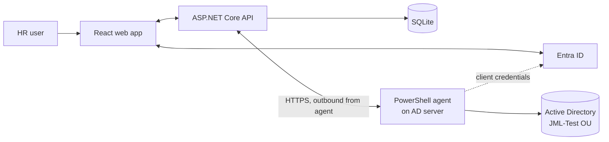

# JML Portal (Joiner, Mover, Leaver)

A lightweight identity lifecycle tool. HR uploads a CSV of new joiners in a web portal, and an agent running next to Active Directory creates the accounts with PowerShell and reports the status back.

> Status: working MVP for a lab environment. Joiner flow only. Mover and Leaver are planned. See the [roadmap](#roadmap) and [known limitations](#known-limitations) before using this anywhere near production.

## Features

- Sign-in with Microsoft Entra ID (OAuth 2.0 / OpenID Connect via MSAL)
- Role-based access: only users with the `JML.HR` app role can upload and view
- CSV upload with drag and drop, header and row validation, and a downloadable template
- Live status per person (Pending, Processing, Success, Failed) with auto-refresh
- Account creation in a target OU with a random temporary password and forced change at first logon
- Temporary password is stored encrypted and can be revealed once by HR (the reveal is recorded)
- Agent talks to the API outbound only. No inbound port to the AD network
- Agent runs as a least-privilege service account with rights on one OU only

## Architecture



Flow:

1. HR signs in. The SPA gets a token for the API.
2. HR uploads a CSV. The API validates it and stores one row per joiner as `Pending`.
3. The agent asks the API for work (long polling), marks rows `Processing`, and runs `New-ADUser`.
4. The agent reports `Success` or `Failed` (plus the temporary password, which is encrypted on arrival).
5. The web page shows the status. HR reveals the password once and shares it securely.

Why the agent pulls instead of the API pushing: the AD server never accepts inbound connections from the application, so no firewall hole and no stored domain credentials in the web tier.

## Tech stack

| Part | Technology |
|---|---|
| Frontend | React (Vite), MSAL.js |
| Backend | ASP.NET Core minimal API, EF Core, SQLite, Microsoft.Identity.Web |
| Auth | Entra ID app registrations (SPA, API, Agent) with app roles |
| Agent | PowerShell, ActiveDirectory module, Windows Task Scheduler |

## Repository layout

```
jml/
  JmlApi/            ASP.NET Core API
  jml-web/           React frontend
  agent/Agent.ps1    PowerShell agent
  samples/joiners.csv
```

## Prerequisites

- .NET SDK (the project targets the version in `JmlApi.csproj`)
- Node.js LTS
- An Entra ID tenant where you can create app registrations
- A Windows Server with Active Directory and the `ActiveDirectory` PowerShell module (use a lab domain)

## Setup

### 1. Entra ID

Create three app registrations (single tenant):

| Registration | Purpose | Configuration |
|---|---|---|
| `JML-API` | The backend | Expose an API, scope `access_as_user`. App roles: `JML.HR` (users) and `JML.Agent` (applications) |
| `JML-Web` | The SPA | Platform: Single-page application, redirect URI `http://localhost:5173`. API permission: `JML-API / access_as_user` |
| `JML-Agent` | The agent | A client secret. Application permission: `JML-API / JML.Agent` with admin consent |

Assign the `JML.HR` role to HR users under Enterprise applications > JML-API > Users and groups.

### 2. API

Edit `JmlApi/appsettings.json` and fill the `AzureAd` block with your tenant ID and the `JML-API` client ID. Do not commit real secrets.

```
cd JmlApi
dotnet run
```

The API creates `jml.db` on first start.

For the HTTPS endpoint used by the agent, create a certificate that covers the API host name or IP, set the Kestrel endpoint in `appsettings.json`, and store the certificate password with `dotnet user-secrets`. Never commit the `.pfx`.

### 3. Frontend

Edit `jml-web/src/authConfig.js` with the `JML-Web` client ID, the tenant ID, the API scope and the API URL.

```
cd jml-web
npm install
npm run dev
```

Open `http://localhost:5173`.

### 4. Agent (on the AD server)

1. Create a target OU, for example `OU=JML-Test,DC=corp,DC=local`.
2. Create a service account (for example `svc-jml`) outside that OU and delegate only user create/delete and full control of user objects on the OU with `dsacls`.
3. Grant the account "Log on as a batch job" through a GPO linked to the right OU (on a domain controller, the Default Domain Controllers Policy).
4. Copy `agent/Agent.ps1` to `C:\JML`, then set the values in its settings block (tenant ID, agent client ID, API client ID, API URL, target OU, UPN suffix).
5. Store the agent secret encrypted with DPAPI in `C:\JML\secret.bin` and restrict the file to the service account.
6. Import the API certificate into `LocalMachine\Root` if you use a self-signed certificate.
7. Register a scheduled task (trigger: at startup) that runs `Agent.ps1 -Loop` as the service account.

## CSV format

```
FirstName,LastName,Department,JobTitle,Manager
John,Smith,IT,Engineer,Sarah Lee
```

The header must match exactly. Rows with fewer or more than five columns, or without a first and last name, are rejected before anything is saved.

## Security notes

- The temporary password is encrypted at rest with ASP.NET Data Protection and deleted on first reveal. Keep the `keys/` folder safe and backed up. Losing it makes stored passwords unreadable.
- The agent secret lives only on the AD server, encrypted with DPAPI.
- Never commit: `*.pfx`, `keys/`, `jml.db`, `secret.bin`, `appsettings` files containing secrets, logs.
- Use a private repository until the placeholders and secrets are cleaned up.

## Known limitations

- Lab-grade only. Self-signed certificate, SQLite, single API instance.
- If the agent creates a user and crashes before reporting, the retry reports "already exists" and the password is lost (HR must reset it in AD).
- Rows can stay in `Processing` after an agent crash (recovery is on the roadmap).
- The reveal flow shows the password to HR. Direct delivery to the user or their manager would be safer.
- Joiner only. No moves, no leavers, no approvals.
- Database schema is created with `EnsureCreated`, not migrations.
- Filters in the agent are built from CSV values and need hardening against special characters (quotes, LDAP characters).

## Roadmap

### Next sprint (stability)

- [ ] Recover rows stuck in `Processing` (claim timestamp, return to `Pending` after a timeout)
- [ ] Treat "user already exists and was created by this job" as success
- [ ] Retry button for failed rows
- [ ] Switch the agent to long polling so accounts start within a second of an upload
- [ ] Validate the CSV against AD before creating anything (duplicate names, missing manager, unknown department) with a dry-run mode
- [ ] Escape and validate all CSV values used in AD filters and CSV injection in exports
- [ ] Structured logging and a health endpoint

### Joiner features

- [ ] Manager lookup by email or employee ID instead of display name
- [ ] Group membership and OU placement by department or role template
- [ ] Employee ID, start date and scheduled creation
- [ ] Email notification to the manager and HR when a batch finishes
- [ ] Deliver the temporary password to the manager or by SMS instead of showing it in the portal
- [ ] Optional Entra ID Connect sync wait and mailbox/licence assignment

### Mover and Leaver

- [ ] `Type` column on the job table (Joiner, Mover, Leaver) reusing the same pipeline
- [ ] Mover: change department, title, manager, groups and OU
- [ ] Leaver: disable account, remove groups, move to a disabled OU, set an expiry date, hide from the address list
- [ ] Approval step for Leavers and sensitive moves

### Security and platform

- [ ] HTTPS with a certificate from an internal CA
- [ ] Agent authentication with a certificate or a gMSA-based flow instead of a client secret
- [ ] Secrets in Azure Key Vault
- [ ] Separate roles (HR, Approver, Auditor, Admin) and an audit log page with export
- [ ] Rate limiting and upload size limits
- [ ] Move from SQLite to SQL Server or Azure SQL, with EF Core migrations
- [ ] Run the API as a Windows service, behind IIS, or on Azure App Service
- [ ] Two agents for high availability (the claim step already prevents double processing)

### Quality and delivery

- [ ] Unit tests for CSV parsing and API endpoints
- [ ] GitHub Actions: build, test, lint, dependency and secret scanning
- [ ] Environment-specific configuration and a deployment guide
- [ ] Screenshots and a demo in this README
